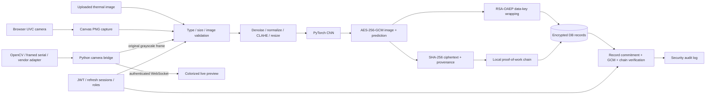

# EmoTherm SecureChain

A multi-page thermal emotion research application: React/Vite, FastAPI, PyTorch, AES-256-GCM with RSA key wrapping, and a local hash-linked private blockchain. All fifteen requested pages have distinct routes and use the live API. No fabricated predictions or analytics are included.

## Start locally on Windows

Run commands from this project folder. Python 3.11+ and Node 22.12+ are recommended.

```powershell
python -m venv .venv
.\.venv\Scripts\Activate.ps1
python -m pip install -r backend/requirements.txt
python scripts/init_env.py
python -m scripts.create_admin --email admin@example.com --name "Project Administrator"
python -m uvicorn backend.main:app --host 127.0.0.1 --port 8000
```

`init_env.py` preserves any existing `.env`. A private `.env` was generated during local verification; recreate it if setting up a new copy. Admin provisioning asks for a password privately. Public signup always creates a User, never an Admin. Researchers have the same scan permissions as Users; Admins additionally manage accounts and system metrics.

### Launch the included built application

For a quick local demo, the archive includes a verified frontend build. After installing Python dependencies, generating `.env`, and optionally provisioning an Admin, start everything from one origin:

```powershell
python -m scripts.serve_preview --port 5173
```

Open **http://localhost:5173**; Swagger is at **http://localhost:5173/docs**. This serves the built React pages plus the complete API and WebSocket. You can use signup immediately. No public hosting or third-party upload of your dataset is involved. This launch method does not require Node unless you change the frontend.

For frontend edits use the normal two-terminal development instructions below. `npm run build` uses the separate in-process Babel configuration to support restricted Windows environments; `npm run build:standard` produces the ordinary optimized Vite build on unrestricted hosts. The portable build targets modern browsers and is intentionally unminified for explainability. Both outputs serve the same application.

In a second terminal:

```powershell
cd frontend
npm ci
npm run dev -- --port 5173 --strictPort
```

Open **http://localhost:5173**. API documentation: **http://localhost:8000/docs**. Health endpoint: `/api/health`. Use the same browser hostname throughout so the refresh cookie remains available. The Vite proxy forwards `/api` and its WebSocket to Python.

After dependencies are installed, `scripts/start-local.ps1` starts both services in hidden windows and prints process IDs. For a new installation, activate the virtual environment first.

## Your dataset and trained baseline

Configured root: `C:/Users/suhas/Downloads/dataset/trainit`.

The supplied layout mixes thermal and visible images. Ingestion recursively selects `TI` and `… th` folders and excludes `VI` and `… vi` folders. Folder prefixes and the trailing `F` are removed to obtain these labels:

| Emotion | Thermal files before deduplication |
| --- | ---: |
| sad | 202 |
| surprise | 69 |
| disgust | 149 |
| happy | 217 |
| neutral | 201 |
| Total | 838 |

Simple `dataset/<emotion>/*.jpg` layouts also work. Never mix visible photographs into thermal training unintentionally.

```powershell
python -m ml.train --dataset "C:\Users\suhas\Downloads\dataset\trainit" --epochs 20
```

The active classifier is `ml/artifacts/model_v2.npz`, a HOG feature extractor with multinomial logistic regression. On the fixed stratified 20% holdout it reached **83.6% accuracy** (138/165 images), compared with **35.8%** for the original CNN baseline retained as `model.pt`. The deployment artifact is refit on all 825 usable images after evaluation. The image-level split can contain the same participant in training and test, so validate on subject-disjoint data before claiming performance on new people. No medical or diagnostic interpretation is intended.

Seven byte-identical duplicates and six unreadable images were excluded, leaving **825 unique usable images**. The six unreadable files are `d20.png` through `d25.png` in `3. DISGUST F/disgust final th`; their paths are recorded in the metrics JSON. The source dataset was not modified.

The default split is stratified by image: 60% train, 20% validation, 20% test after exact-image deduplication. The test set is evaluated only after choosing the best checkpoint by validation loss. Subject overlap is unknown. For defensible evaluation on new people, identify subject IDs from dataset documentation and supply a regex with capture group 1 holding subject ID:

```powershell
# Example only: replace with the naming convention actually used by your dataset.
python -m ml.train --dataset "C:\Users\suhas\Downloads\dataset\trainit" --subject-regex "subject_(\d+)" --epochs 40
```

This uses disjoint subject groups in all three splits. Training fails if a split lacks an emotion class. Metrics page reports the split method explicitly. Class weights counter class imbalance. The grayscale pipeline uses Gaussian denoising, intensity normalization, CLAHE, and 96×96 resizing. Palette-colored thermal exports are treated as grayscale intensity images; radiometric fidelity and suitability for real camera input must be evaluated separately. Loss/accuracy charts and confusion matrix SVGs can be used in the project report.

## Sitemap

| Audience | Route | Page |
| --- | --- | --- |
| Public | `/` | Landing |
| Public | `/about` | How it works |
| Public | `/login` | Login |
| Public | `/signup` | Signup |
| Authenticated | `/dashboard` | Summary and recent scans |
| Authenticated | `/upload` | Image input and preprocessing preview |
| Authenticated | `/capture` | Browser and Python bridge capture |
| Authenticated | `/results/:id` | Prediction, confidence distribution, integrity verification |
| Authenticated | `/history` | Own records with date/emotion/source filters |
| Authenticated | `/blockchain` | Hash search and chain browser |
| Authenticated | `/settings` | Profile, password, camera mode, light/dark appearance |
| Admin | `/admin` | System analytics |
| Admin | `/admin/users` | Roles and account access |
| Admin | `/admin/metrics` | Evaluation and training history |
| Admin | `/admin/audit` | Security actions with filters |

## Architecture



Folder structure:

```text
frontend/    React routes, design system, browser camera, charts
backend/     FastAPI, SQLAlchemy schema, auth, crypto, REST and WebSocket
ml/          Thermal ingestion, preprocessing, CNN, training, inference, artifacts
blockchain/  Canonical commitments, block mining, chain validation, optional Solidity
camera/      OpenCV, real framed-serial parser, vendor adapter interface
scripts/     Environment secrets, admin provisioning, launch, localhost certificate
docs/        Camera protocol, security model, demo guide, verification record
tests/       Auth, permissions, record tampering, crypto and camera path tests
```

## Encryption and verification

1. A fresh 32-byte AES data key is generated per scan. Independent random 12-byte nonces encrypt the image and full prediction JSON using AES-GCM. The scan UUID is associated authenticated data.
2. RSA-3072 OAEP with SHA-256 wraps the AES key. The RSA private key is encrypted at rest by the deployment's AES master key. Preserve the master key and encrypted RSA key in backups; losing either makes historical records undecryptable.
3. SHA-256 commits to both ciphertexts plus canonical scan ID, owner, timestamp, and capture source. Chain blocks contain index, timestamp, commitment, previous hash, nonce, and block hash. Mining requires a `00` hash prefix for an explainable demonstration.
4. The image, result and block are saved in one database transaction. PostgreSQL row locking serializes chain append. SQLite plus an in-process lock is the local default.
5. Verification recomputes the commitment, authenticates both ciphertexts with GCM, and checks every chain link, index, block hash, and proof-of-work prefix. Admin tamper demonstration changes an in-memory copy and proves its validation fails, preserving research evidence.

Blockchain is an integrity ledger; encryption is performed by AES/RSA rather than by blockchain itself. A single-authority private chain is tamper-evident, not an independently immutable distributed system. See `docs/security.md`.

### Signed verification certificates

Every authorized scan owner can download a two-page PDF certificate and its companion machine-readable JSON certificate from the result page. The JSON payload is signed with RSA-PSS-SHA256 and contains the scan identifier, full probability distribution, model version and artifact hash, original-image hash, record commitment, block index, block hashes, and integrity results. The PDF includes a QR code linking to the public verification page.

The public `/verify-certificate` page accepts the signed JSON or a QR-linked scan reference. It independently recomputes the canonical report hash, verifies the signature against this installation's RSA public key, checks the current blockchain commitment, and confirms the active model artifact hash. The public verification key is downloadable from the same page. Encryption keys and decrypted images are never included in a certificate.

## Camera configuration

Both user-selectable paths submit to the same inference/encryption/chain pipeline.

**Browser/UVC:** select Browser / UVC in Live Capture, connect, allow permission, select a thermal video device, reconnect, and capture. Browser permission requires localhost or HTTPS. An ordinary webcam is accessible but its images are not thermal data.

**OpenCV bridge:** set `CAMERA_DRIVER=opencv` and `CAMERA_SOURCE=0` (or another device index, RTSP URL, or a local video path). Restart Python after changing driver configuration. Python bridge mode streams Inferno previews and captures the grayscale frame on the server.

**Serial bridge:** set `CAMERA_DRIVER=serial`, serial port, baud rate, width and height. The implemented protocol is documented in `docs/camera.md`. It parses actual bytes from a serial device. A camera that uses a proprietary serial protocol needs a matching adapter.

**Vendor SDK:** set `CAMERA_DRIVER=vendor` and `CAMERA_PLUGIN=your_adapter`. The installed module implements `open_camera()`, returning a device exposing `read()` and `release()`. The bridge is functional, but the vendor adapter cannot be written or hardware-tested until the camera model and SDK are known. No claim of universal camera compatibility is made.

WebSockets use a single-use, 60-second ticket tied to a revocable authenticated session. The UI receives no long-lived access token in its URL. Stream authorization is rechecked during capture, and captures require a recent frame owned by that user. The original grayscale bridge frame is submitted by the backend, not the preview colormap.

On Windows, a host Python process is recommended for USB/COM hardware: Docker Desktop may not expose camera devices. The browser UVC path remains usable with the Docker application. On Linux, grant container access only to the chosen video/serial device.

## Docker / PostgreSQL demo

Generate `.env` and add `POSTGRES_PASSWORD=<a randomly generated alphanumeric password>`. Use an alphanumeric password because the example embeds it in a database URL; URL-encode reserved characters if needed. Secrets have no defaults.

```powershell
docker compose up --build -d
docker compose exec backend python -m scripts.create_admin --email admin@example.com
```

Open **http://localhost:8080**. This runs React/Nginx, FastAPI, and PostgreSQL. Records and keys persist in Docker volumes. Model artifacts are mounted so retraining on the host updates inference. The dataset stays on the host and is not copied into the Docker image. To train inside the backend, explicitly mount your dataset read-only at `/dataset` first.

For HTTPS, generate a certificate with `python scripts/create_cert.py`, use `frontend/nginx.https.conf.example` as the frontend Nginx configuration, mount `./data/certs:/etc/nginx/certs:ro`, expose `8443:443`, and set `COOKIE_SECURE=true` plus `CORS_ORIGINS=https://localhost:8443`. Rebuild the frontend and restart the backend. Self-signed certificates require local browser trust for camera access; use trusted certificates for deployment.

## Security and tests

Passwords use bcrypt; access tokens expire in 15 minutes; rotating refresh tokens use HttpOnly SameSite=Strict cookies and a stored SHA-256 token hash. Sessions are revoked on logout and password changes. Role checks and record ownership are enforced server-side. Files are limited to 10 MB and 20 million pixels with strict encoding/MIME checks. Login, preprocessing, upload, capture, and camera tickets are rate limited. Login failures and successful research/security actions are audited.

```powershell
python -m pytest tests -q
cd frontend
npm run build
```

The local limiter and camera ownership registry are process-local: use one worker for this demo. Distributed deployment needs a shared rate limiter, a dedicated capture service, migrations, monitored key rotation, and external ledger anchoring. Docker and physical camera validation depend on host hardware availability; see `docs/verification.md` for what was actually tested.

## Optional Ethereum path

`blockchain/EmoTherm.sol` is a commitment contract example. To adopt a local Ethereum testnet, compile/deploy it using Hardhat, configure Web3.py against the testnet, and replace chain append/verification with `commit`/`verifyRecord` calls. Store transaction receipts and retry durable queued commitments if inference DB writes succeed but Ethereum submissions fail. Hash encrypted image and prediction separately, preserve ownership/provenance inside authenticated prediction metadata, and keep encryption off-chain. The Python chain is the implemented default; Ethereum is an extension guide, not an active integration. No real currency is required.

Technical references: [FastAPI JWT security](https://fastapi.tiangolo.com/tutorial/security/oauth2-jwt/), [PyTorch safe checkpoint loading](https://docs.pytorch.org/docs/stable/generated/torch.load), [Vite setup](https://vite.dev/guide/).
# EMOTherm
