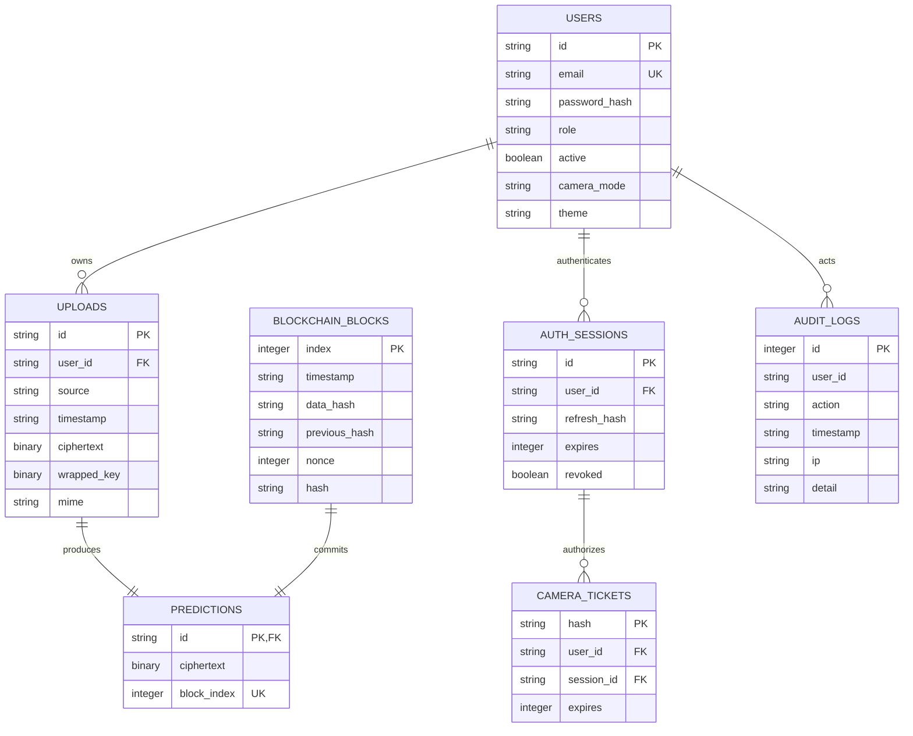

# Database schema

SQLAlchemy models in `backend/models.py` are the executable schema. The local demo uses SQLite; Compose overrides the connection URL with PostgreSQL. All record IDs use UUID strings. ISO 8601 UTC timestamps are stored in sortable string form for this demonstration.

The diagram expresses logical relationships; prediction-to-block and audit-to-user references are logical links rather than physical foreign-key constraints in the demo schema. The `chain_lock` table contains one sentinel row used to serialize append transactions in PostgreSQL. Plain emotion labels, probabilities and confidence are stored inside prediction ciphertext, not as unencrypted prediction columns. Lists decrypt results only after checking authorization.

Images are encrypted binary DB objects, so no raw uploaded image paths are persisted. `data/rsa-private.pem.enc` contains the master-key-encrypted RSA private key. Audit rows and account profile fields remain plaintext as documented in the security model.

No migration engine is included; create_all supports initial setup. Add Alembic before making schema changes to an existing deployment.
